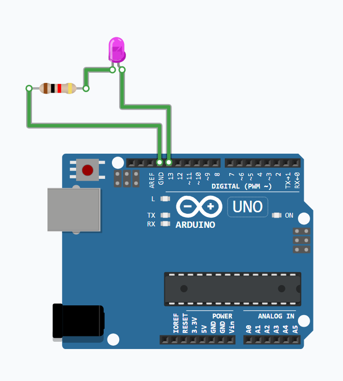
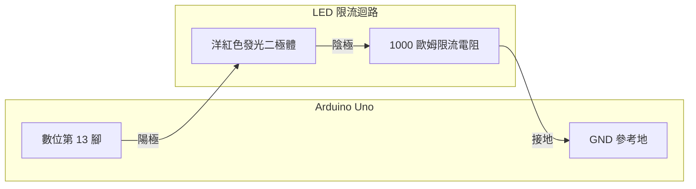

# Blink 基礎 LED 閃爍控制

## 簡介
對應 Arduino 官方內建範例 `01.Basics -> Blink`，透過 `digitalWrite()` 與 `delay()` 切換數位腳位高低電位，控制外接洋紅色發光二極體以亮 100 毫秒、暗 500 毫秒之節奏週期性閃爍。

## 硬體接線表

| 元件名稱 | 元件腳位 | Arduino Uno 腳位 | 備註說明 |
| :--- | :--- | :--- | :--- |
| 洋紅色 LED | 陽極正極 | 數位腳位 13 | 輸出高電位時導通發光 |
| 洋紅色 LED | 陰極負極 | 限流電阻端 | 串接 1000 歐姆限流電阻 |
| 限流電阻 | 接地端 | GND | 系統共用參考地線 |

## 電路佈局圖

### 訊號流向圖

## 電路與韌體設計要點
1. **1000 歐姆限流設計**：採用 1 kΩ 電阻串聯於 LED 陰極與 GND 之間，在 5V 供電下將導通電流限制於約 2 至 3 毫安培，兼顧肉眼可視亮度與極低功耗。
2. **非對稱閃爍節奏**：設定點亮 100 毫秒、熄滅 500 毫秒，總週期 600 毫秒，呈現近似心跳指示燈之短促閃爍視覺效果。
3. **阻塞式延遲特性**：`delay()` 執行期間 CPU 停等於內部計時迴圈，適合單純硬體腳位驗證，若需多工處理請參考 `02_digital/BlinkWithoutDelay`。

## 模擬方式
* 複製本目錄之 `sketch.ino` 與 `diagram.json` 內容至 Wokwi 線上編輯器即可直接執行模擬。
