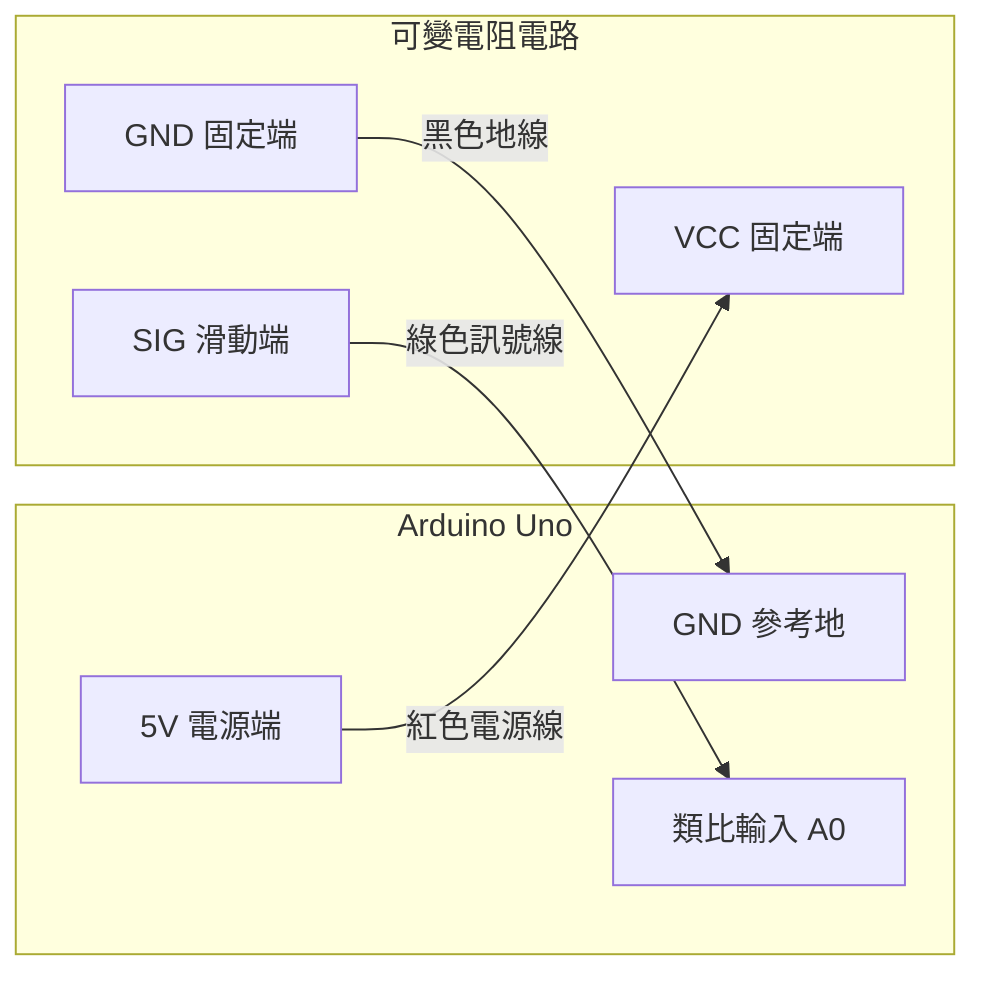

# 02 AnalogReadSerial 類比讀取與序列埠輸出

## 簡介
透過類比接腳讀取可變電阻分壓訊號，經由微控制器內部 10 位元 ADC 轉換為 0 至 1023 的整數數值，並透過序列埠以 115200 波特率即時輸出至電腦終端機。

## 硬體接線表

| 元件名稱 | 元件腳位 | Arduino Uno 腳位 | 備註說明 |
| :--- | :--- | :--- | :--- |
| 可變電阻 | VCC 電源端 | 5V | 分壓電路高電位參考端 |
| 可變電阻 | GND 接地端 | GND | 系統參考地線 |
| 可變電阻 | SIG 訊號端 | 類比接腳 A0 | 滑動端類比電壓輸入 |

## 電路連接圖

## 電路與韌體設計要點
1. **電阻分壓原理**：可變電阻兩端跨接 5V 與 GND，滑動端輸出電壓與旋轉角度成線性正比，輸出電壓範圍介於 0V 至 5V。
2. **10 位元 ADC 取樣**：ATmega328P 內建 10 位元逐次逼近型轉換器，量化範圍為 0 至 1023，單階解析度約為 4.88 毫伏特。
3. **序列埠通訊配置**：採用 115200 波特率進行高速字元串流輸出，相較於官方預設 9600 波特率，具備更短的傳輸延遲與更高的頻寬。
4. **取樣穩定延遲**：每次取樣後加入 1 毫秒延遲，提供內部取樣保持電容充放電穩定時間，避免連續切換通道時之電壓殘留誤差。

## 模擬方式
* 複製本目錄之 sketch.ino 與 diagram.json 內容至 Wokwi 線上編輯器即可直接執行模擬。
* 旋轉電位計旋鈕，可在 Serial Monitor 視窗中觀察到 0 至 1023 的即時數值變化。
