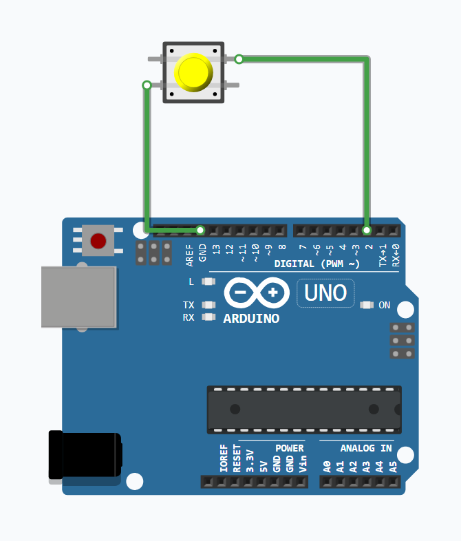
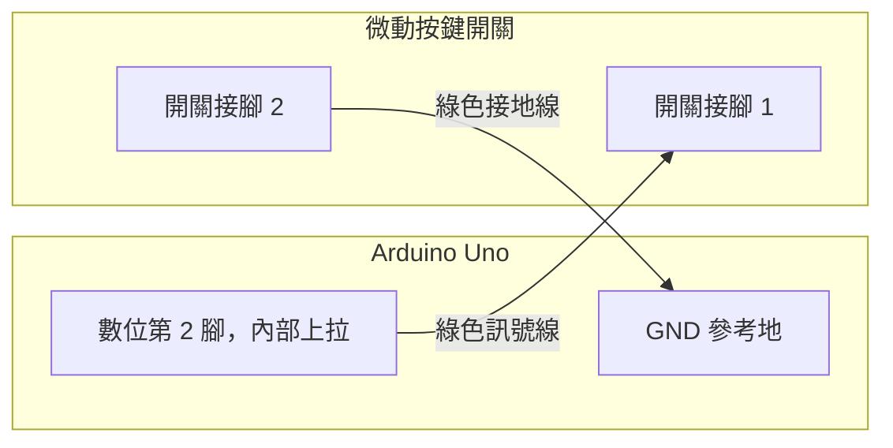

# 03 DigitalReadSerial 數位讀取與序列埠輸出

## 簡介
透過數位輸入接腳讀取按鍵開關狀態，啟用微控制器內部上拉電阻消除浮接雜訊，並透過序列埠以 115200 波特率即時傳送開關邏輯電位至電腦終端機。

## 硬體接線表

| 元件名稱 | 元件腳位 | Arduino Uno 腳位 | 備註說明 |
| :--- | :--- | :--- | :--- |
| 按鍵開關 | 第一端 | 數位第 2 腳 | 微控制器輸入偵測端 |
| 按鍵開關 | 第二端 | GND 接地端 | 系統共用參考地線 |

## 電路佈局圖

### 訊號流向圖

## 電路與韌體設計要點
1. **內部上拉電阻**：配置 `pinMode(BTN, INPUT_PULLUP)` 啟用 ATmega328P 內部約 20K 至 50K 歐姆的弱上拉電阻，按鍵未按下時維持穩定的 5V 高電位，無需在外部額外焊接上拉電阻。
2. **負邏輯輸入特性**：按鍵常態未按下時接腳維持高電位 1；當按鍵按下閉合時接腳直接短路接地拉為低電位 0。
3. **序列通訊傳輸**：採用 115200 波特率將即時邏輯電位回傳電腦，縮減傳送延遲並提高主迴圈更新頻率。

## 模擬方式
* 複製本目錄之 sketch.ino 與 diagram.json 內容至 Wokwi 線上編輯器即可直接執行模擬。
* 點擊電路圖上的按鈕，可在 Serial Monitor 視窗中觀察到數值由 1 轉為 0，放開後恢復為 1。
