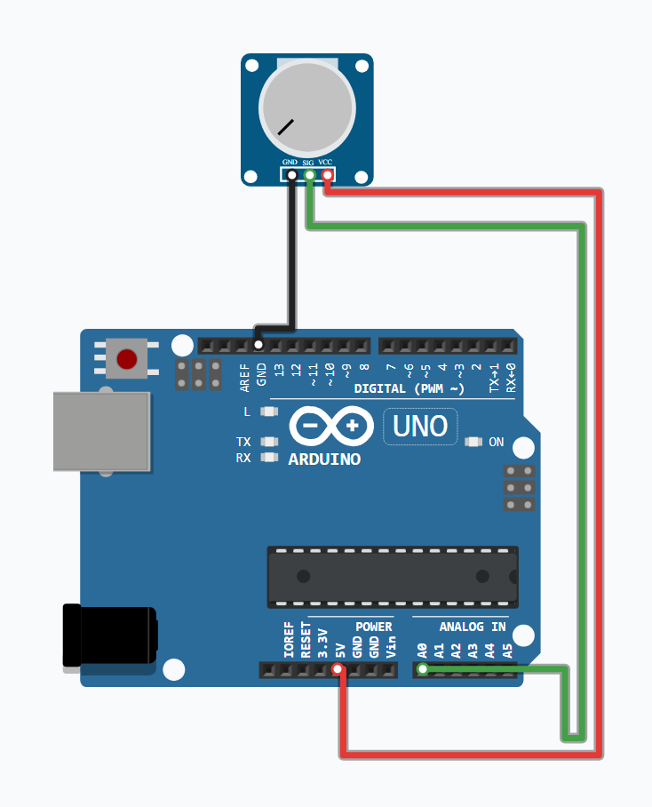
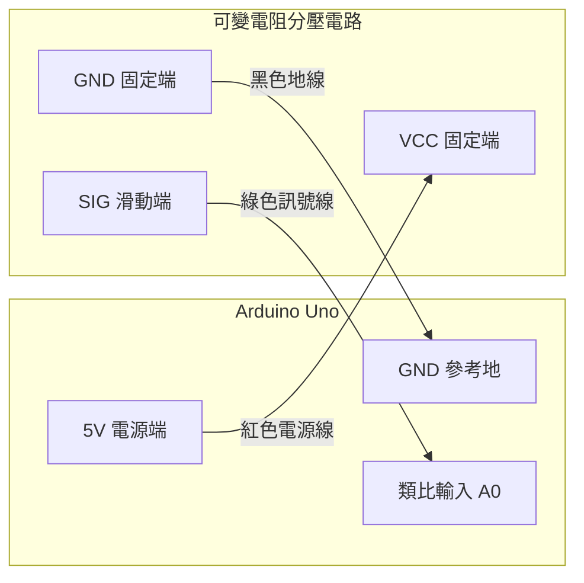

# 05 ReadAnalogVoltage 類比電壓換算與輸出

## 簡介
透過類比輸入接腳讀取分壓訊號，經微控制器 10 位元 ADC 取樣後換算為實際伏特電壓值，並透過序列埠以 115200 波特率輸出至電腦終端機。

## 硬體接線表

| 元件名稱 | 元件腳位 | Arduino Uno 腳位 | 備註說明 |
| :--- | :--- | :--- | :--- |
| 可變電阻 | VCC 電源端 | 5V | 分壓電路高電位參考端 |
| 可變電阻 | GND 接地端 | GND | 系統參考地線 |
| 可變電阻 | SIG 訊號端 | 類比接腳 A0 | 滑動端類比電壓輸入 |

## 電路佈局圖

### 訊號流向圖

## 電路與韌體設計要點
1. **ADC 量化階數與解析度**：ATmega328P 內建 10 位元逐次逼近型 ADC，量化階數為 1024 階。在 5V 參考電壓下，最低有效位元 LSB 解析度約為 4.88 毫伏特。
2. **浮點數電壓換算公式**：轉換公式為使用讀取之 ADC 數值乘上 5.0 除以 1024.0，將 0 至 1023 量化數值映射為 0.00V 至 4.995V 物理電壓。
3. **序列埠高速傳輸**：採用 115200 波特率將即時電壓輸出至序列埠監視器，避免低速傳輸阻塞主迴圈。

## 模擬方式
* 複製本目錄之 sketch.ino 與 diagram.json 內容至 Wokwi 線上編輯器即可直接執行模擬。
* 旋轉電位計旋鈕，可在 Serial Monitor 視窗中觀察到 0.00V 至 5.00V 的即時電壓變化。
