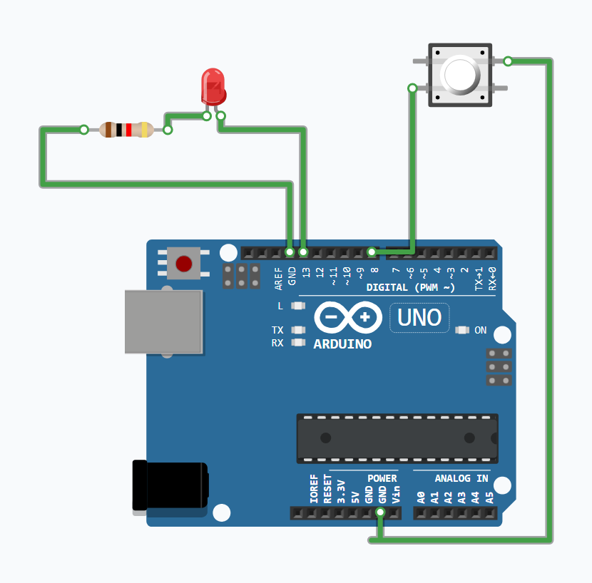
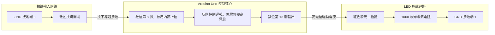

# Button 按鍵輸入與 LED 控制

## 簡介

對應 Arduino 官方內建範例 02.Digital 之 Button，透過數位第 8 腳啟用內部上拉電阻讀取按鍵開關狀態，並控制數位第 13 腳紅色發光二極體之亮滅，同時將狀態以 115200 波特率傳送至序列埠。

## 硬體接線表

| 元件名稱 | 元件腳位 | Arduino Uno 腳位 | 電氣特性說明 |
| :--- | :--- | :--- | :--- |
| 紅色發光二極體 | 陽極 | 數位第 13 腳 | 輸出高電位時導通點亮 |
| 紅色發光二極體 | 陰極 | 限流電阻第一端 | 串聯 1000 歐姆限流電阻 |
| 限流電阻 | 第二端 | GND 接地端 1 | 系統共用參考地線 |
| 按鍵開關 | 接腳 2.l | 數位第 8 腳 | 啟用內部上拉電阻輸入偵測端 |
| 按鍵開關 | 接腳 1.r | GND 接地端 3 | 開關閉合時導通至參考地 |

## 電路佈局圖

### 訊號流向圖

## 電路與韌體設計要點

1. **內部上拉電阻**：設定 `pinMode(BTN, INPUT_PULLUP)` 啟用 ATmega328P 內部約 20k 至 50k 歐姆的上拉電阻，按鍵常態懸空時維持 5V 高電位，省去外部焊接上拉電阻的空間與成本。
2. **負邏輯輸入轉換**：按鍵未按下時接腳維持高電位 1；按下時導通接地成為低電位 0。韌體邏輯透過判斷式反轉訊號，當讀取值為低電位時輸出高電位點亮發光二極體，達成直觀的按壓亮燈效果。
3. **限流保護設計**：發光二極體陰極串聯 1000 歐姆電阻連接至接地端，將順向工作電流限制在約 3 mA 安全範圍內，保護微控制器接腳與二極體不致過載。
4. **序列埠除錯通訊**：初始化配置 115200 高傳輸率，於每次讀取時輸出當前燈號狀態，方便於終端機即時監看輸入觸發。

## 模擬方式

* 複製本目錄之 `sketch.ino` 與 `diagram.json` 內容至 Wokwi 線上編輯器即可直接執行模擬。
* 按住畫面中的白色微動按鍵，紅色發光二極體隨即點亮，Serial Monitor 印出數值 1；放開按鍵後發光二極體熄滅，Serial Monitor 印出數值 0。
