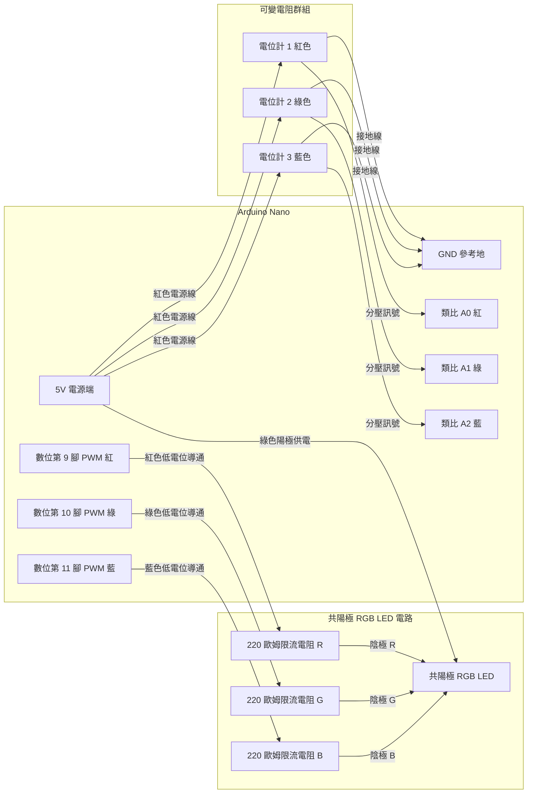

# 01 可變電阻類比讀取與 RGB 調光

## 簡介
透過三組可變電阻分壓電路輸入類比電壓，經微控制器 ADC 轉換後，直接控制三色發光二極體的 PWM 輸出占空比，達成三原色混色與亮度調控。

## 硬體接線表

| 元件名稱 | 元件腳位 | Arduino Nano 腳位 | 備註說明 |
| :--- | :--- | :--- | :--- |
| 可變電阻 1 | SIG 訊號端 | A0 | 紅色通道類比輸入 |
| 可變電阻 2 | SIG 訊號端 | A1 | 綠色通道類比輸入 |
| 可變電阻 3 | SIG 訊號端 | A2 | 藍色通道類比輸入 |
| RGB LED | R 陰極 | 數位腳位 9 | 經 220 歐姆限流電阻 |
| RGB LED | G 陰極 | 數位腳位 10 | 經 220 歐姆限流電阻 |
| RGB LED | B 陰極 | 數位腳位 11 | 經 220 歐姆限流電阻 |
| RGB LED | COM 陽極 | 5V | 共陽極接電源正極 |

所有可變電阻之兩端接腳分別連接 5V 與 GND 構成完整分壓電路。

## 電路連接圖

## 電路與韌體設計要點
1. **位元位移運算優化**：Arduino ADC 解析度為 10 位元，數值範圍 0 至 1023；PWM 輸出解析度為 8 位元，範圍 0 至 255。使用向右位移兩位元 `>> 2` 取代浮點數除法或 map 函式，大幅節省 CPU 運算週期。
2. **共陽極驅動特性**：本電路 RGB LED 採用共陽極接法，COM 腳位連接 5V。當 PWM 輸出 LOW 時電位差最大，燈光最亮；輸出 HIGH 時電位差為零，燈光熄滅。若希望旋鈕順時針轉動為變亮，可於程式中將數值計算改為反相。

## 模擬方式
* Wokwi 線上專案：https://wokwi.com/projects/479628973563660289
* 本目錄包含完整的 sketch.ino 與 diagram.json，可直接於 Wokwi 載入模擬。
