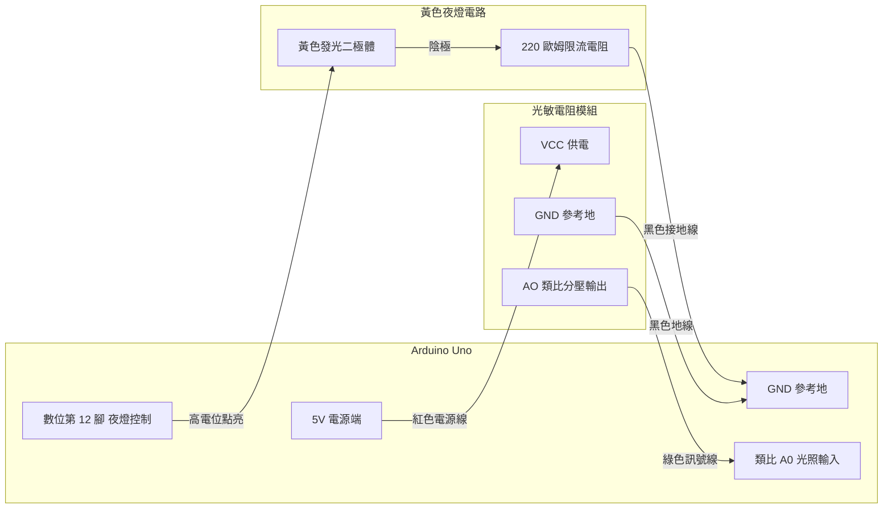

# 02 光敏電阻類比讀取與智慧夜燈

## 簡介
透過光敏電阻分壓模組輸入環境光類比電壓，換算為環境照度 Lux，並設定光照閾值自動控制 LED 夜燈開關，達成環境光感應自動啟閉照明。

## 硬體接線表

| 元件名稱 | 元件腳位 | Arduino Uno 腳位 | 備註說明 |
| :--- | :--- | :--- | :--- |
| 光敏電阻模組 | VCC 電源端 | 5V | 模組主供電 |
| 光敏電阻模組 | GND 接地端 | GND | 系統參考地 |
| 光敏電阻模組 | AO 類比輸出 | 類比接腳 A0 | 環境光分壓電位輸入 |
| 黃色 LED | 陽極正極 | 數位腳位 12 | 輸出驅動信號 |
| 黃色 LED | 陰極負極 | 限流電阻端 | 串接 220 歐姆限流電阻至 GND |
| 限流電阻 | 接地端 | GND | 限制工作電流保護接腳 |

## 電路連接圖

## 電路與韌體設計要點
1. **光敏電阻照度曲線換算**：光敏電阻的光電導特性呈現非線性對數關係，藉由微控制器 ADC 讀取分壓並計算等效電阻後，代入 Gamma 光敏特徵公式換算為實際照度 Lux。
2. **光照閾值判定**：以 400 Lux 作為夜間照明啟動分界點。當照度低於 400 Lux 時自動點亮黃色 LED，高於閾值時則自動熄滅。
3. **序列埠即時遙測**：配置 115200 波特率將即時環境照度 Lux 數值傳送至終端機，便於調試與繪製照度變化曲線。

## 模擬方式
* Wokwi 線上專案：https://wokwi.com/projects/480454114214288385
* 本目錄包含完整的 sketch.ino 與 diagram.json，可直接於 Wokwi 載入模擬。
