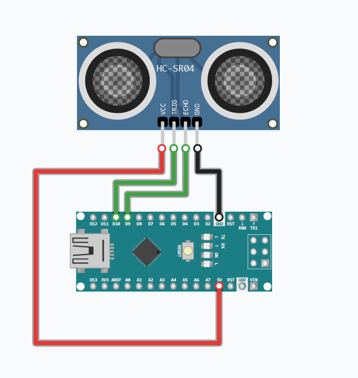
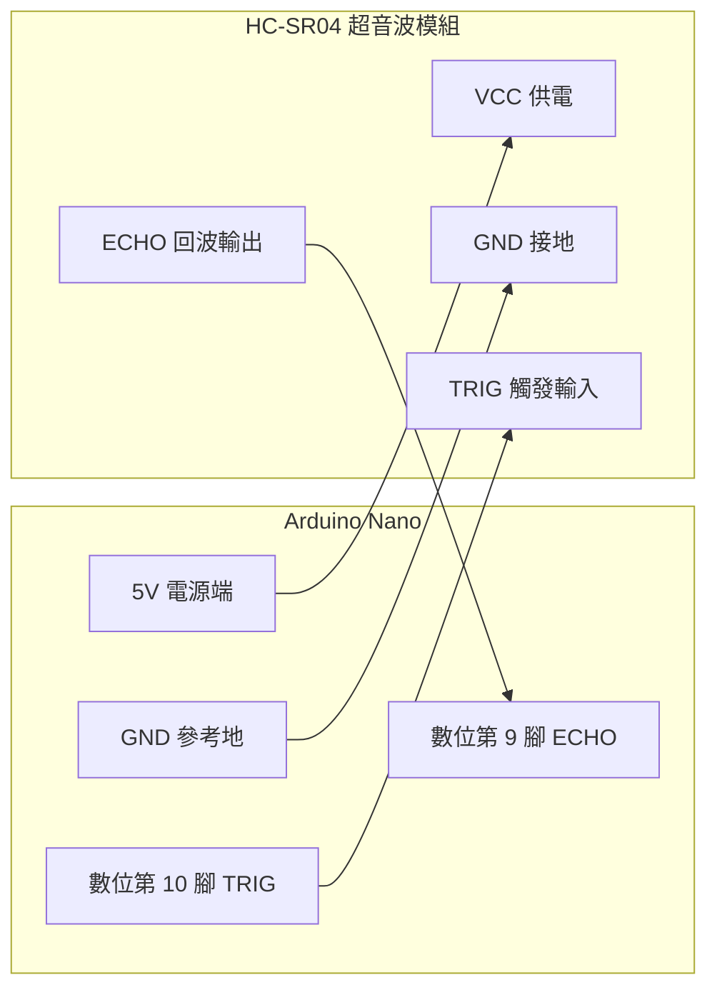

# 03 超音波測距模組 HC-SR04

## 簡介
透過數位腳位送出 10 微秒觸發脈衝啟動 HC-SR04 超音波模組，量測回波高電位脈衝寬度並換算為公分距離，經由序列埠以 115200 波特率即時輸出。

## 硬體接線表

| 元件名稱 | 元件腳位 | Arduino Nano 腳位 | 備註說明 |
| :--- | :--- | :--- | :--- |
| HC-SR04 模組 | VCC 電源端 | 5V | 模組工作供電正極 |
| HC-SR04 模組 | GND 接地端 | GND | 系統共用參考地線 |
| HC-SR04 模組 | TRIG 觸發端 | 數位腳位 10 | 送出 10 微秒高電位啟動測距 |
| HC-SR04 模組 | ECHO 回波端 | 數位腳位 9 | 接收回波高電位脈衝寬度 |

## 電路佈局圖

### 訊號流向圖

## 電路與韌體設計要點
1. **觸發脈衝時序**：透過 `digitalWrite()` 與 `delayMicroseconds(10)` 在 TRIG 腳位產生至少 10 微秒的高電位脈衝，啟動模組發射 8 個週期的 40 kHz 超音波方波。
2. **往返飛行時間換算**：常溫下聲速約為每秒 343 公尺，相當於每公分耗時約 29.1 微秒。由於聲波需往返障礙物兩倍路程，將 `pulseIn(ECHO, HIGH)` 測得之微秒數除以 58 即可直接換算為公分距離。
3. **序列埠即時監控**：設定 115200 波特率將量測結果傳送至序列埠監視器，降低字串輸出對量測週期的影響。

## 模擬方式
* Wokwi 線上專案：https://wokwi.com/projects/480985444812739585
* 本目錄包含完整的 `sketch.ino` 與 `diagram.json`，可直接於 Wokwi 載入模擬並拖曳距離滑桿測試。
