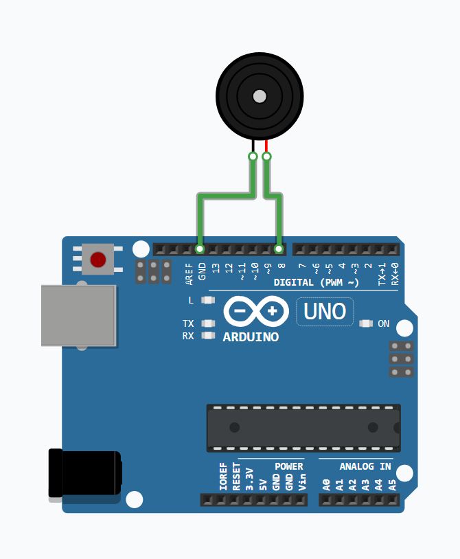
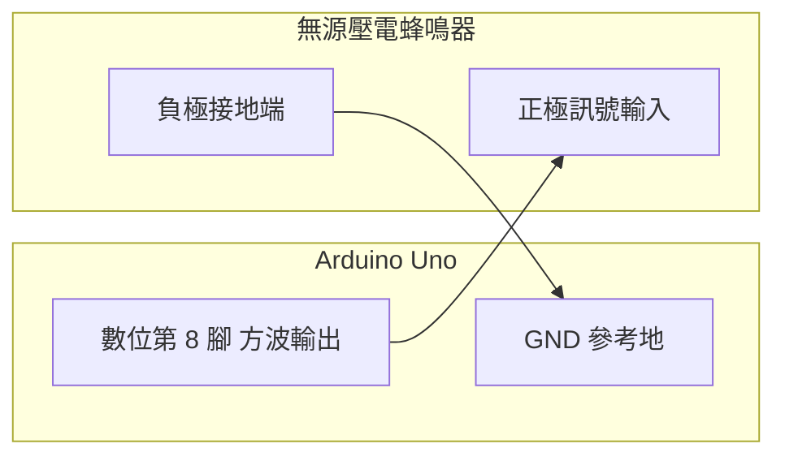

# 01 無源蜂鳴器旋律播放

## 簡介
透過 Arduino 數位腳位搭配 `tone()` 函式輸出特定頻率方波，依序驅動無源壓電蜂鳴器演奏小星星旋律。

## 硬體接線表

| 元件名稱 | 元件腳位 | Arduino Uno 腳位 | 備註說明 |
| :--- | :--- | :--- | :--- |
| 壓電蜂鳴器 | 負極黑線端 | GND | 系統共用參考地線 |
| 壓電蜂鳴器 | 正極紅線端 | 數位腳位 8 | 輸出可變頻率方波驅動發聲 |

## 電路佈局圖

### 訊號流向圖

## 電路與韌體設計要點
1. **方波頻率與音高對應**：陣列 `melody[]` 儲存 14 個音符頻率數值，依序對應中央 C 調的 C4 至 A4 音階，構成小星星主旋律。
2. **編譯期陣列長度計算**：使用 `sizeof(melody) / sizeof(int)` 自動推算音符總數，後續增減旋律內容時不需手動修改迴圈上限。
3. **非阻塞發聲與音符斷奏間隔**：`tone()` 呼叫後會立即返回並由底層 Timer2 背景輸出方波。程式透過 `delay(220 + 50)` 等待 220 毫秒發聲完畢，並保留 50 毫秒靜音間隙，避免連續相同音符黏連。

## 模擬方式
* Wokwi 線上專案：https://wokwi.com/projects/480987870677676033
* 本目錄包含完整的 `sketch.ino` 與 `diagram.json`，可直接於 Wokwi 載入模擬並聆聽旋律輸出。
