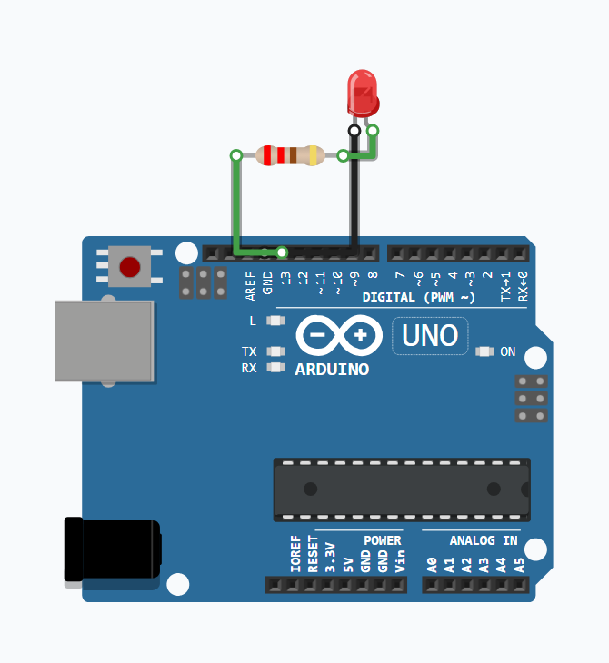
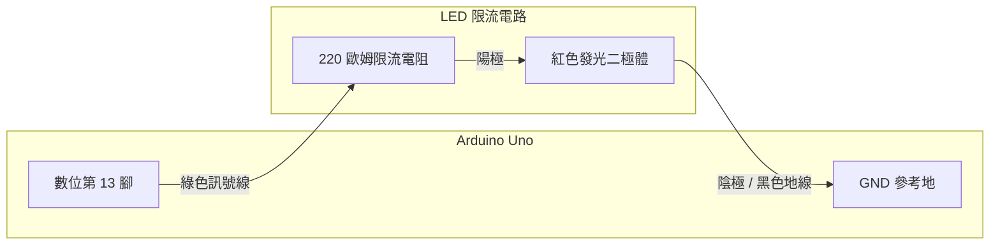

# 01 BlinkWithoutDelay 非阻塞 LED 閃爍

## 簡介
對應 Arduino 官方內建範例 `02.Digital -> BlinkWithoutDelay`，透過 `millis()` 時間戳記差值實作非阻塞輪詢控制發光二極體亮滅，避免主迴圈被 `delay()` 佔用。

## 硬體接線表

| 元件腳位 | Arduino Uno 腳位 | 備註說明 |
| :--- | :--- | :--- |
| LED 陽極 | 數位腳位 13 | 經 220 歐姆限流電阻連接 |
| LED 陰極 | GND | 電路接地端 |

## 電路佈局圖

### 訊號流向圖

## 電路特點
* 使用限流電阻防止發光二極體順向電流過大燒毀。
* 採用非阻塞輪詢架構，主迴圈保留持續處理其他感測器之能力。

## 模擬方式
* 複製本目錄之 sketch.ino 與 diagram.json 內容至 Wokwi 線上編輯器即可直接執行模擬。
