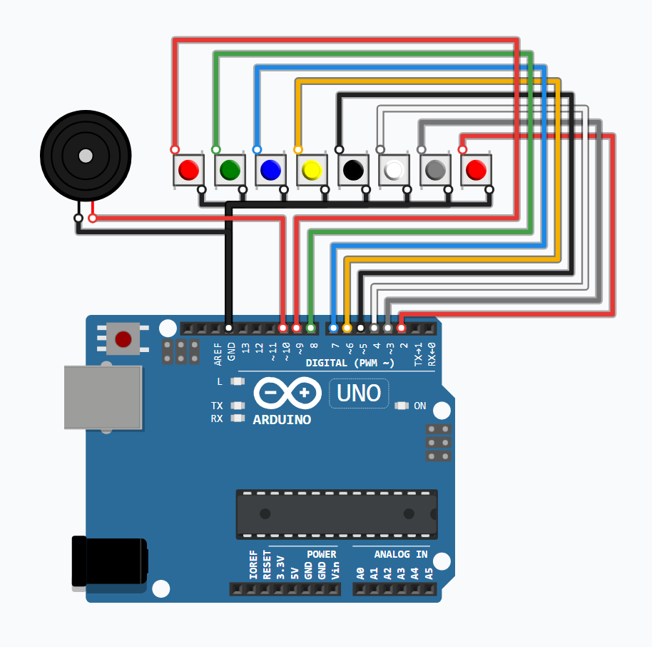
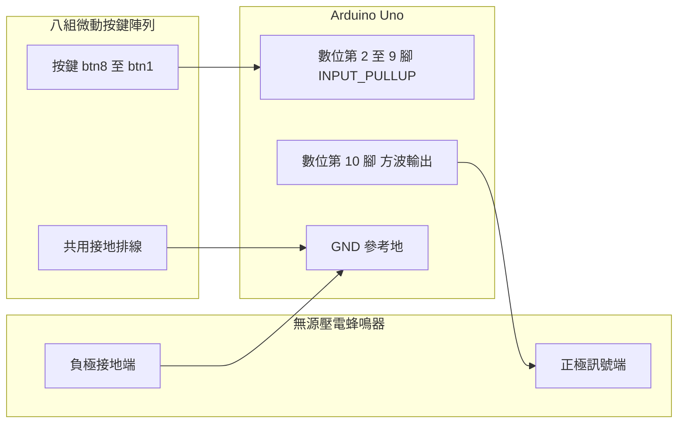

# 05 八鍵電子琴與蜂鳴器實作

## 簡介
透過 8 顆啟用內部上拉電阻的微動按鍵掃描琴鍵狀態，搭配平行陣列查表驅動無源壓電蜂鳴器發出 C4 至 C5 八度音階，並於按鍵切換時在序列埠輸出對應唱名。

## 硬體接線表

| 元件名稱 | 元件腳位 | Arduino Uno 腳位 | 對應音階與頻率 |
| :--- | :--- | :--- | :--- |
| 按鍵 btn8 紅色 | 訊號端 | 數位腳位 2 | C4 Do 262 Hz |
| 按鍵 btn7 灰色 | 訊號端 | 數位腳位 3 | D4 Re 294 Hz |
| 按鍵 btn6 白色 | 訊號端 | 數位腳位 4 | E4 Mi 330 Hz |
| 按鍵 btn5 黑色 | 訊號端 | 數位腳位 5 | F4 Fa 349 Hz |
| 按鍵 btn4 黃色 | 訊號端 | 數位腳位 6 | G4 Sol 392 Hz |
| 按鍵 btn3 藍色 | 訊號端 | 數位腳位 7 | A4 La 440 Hz |
| 按鍵 btn2 綠色 | 訊號端 | 數位腳位 8 | B4 Si 494 Hz |
| 按鍵 btn1 紅色 | 訊號端 | 數位腳位 9 | C5 Do 523 Hz |
| 壓電蜂鳴器 bz1 | 正極端 | 數位腳位 10 | 方波頻率輸出 |
| 所有按鍵與蜂鳴器 | 接地端 | GND | 共用系統參考地線 |

## 電路佈局圖

### 訊號流向圖

## 電路與韌體設計要點
1. **平行陣列查表映射**：以 `KEYS[]`、`NOTES[]` 與 `NAMES[]` 三組同長度陣列透過同一索引 `i` 綁定數位接腳、發聲頻率與唱名字串，取代 8 組重複的條件判斷分支。
2. **內部上拉與共用接地**：全數 8 顆按鍵配置 `INPUT_PULLUP` 啟用內部上拉電阻，只需一條共用接地排線連接 GND，未按下為 HIGH、按下為 LOW。
3. **狀態變化比對避免爆音**：透過 `playing` 與 `pressed` 記錄前後狀態，僅於琴鍵狀態改變時才呼叫 `tone()`、`noTone()` 與 `Serial.println()`，避免主迴圈重複重置 Timer2 造成音訊抖動與序列埠洗版。

## 模擬方式
* Wokwi 線上專案：https://wokwi.com/projects/481014241083317249
* 本目錄包含完整的 `sketch.ino` 與 `diagram.json`，載入 Wokwi 後按住任一彩色按鍵即可演奏音階，並於序列埠監視器觀察唱名輸出。
