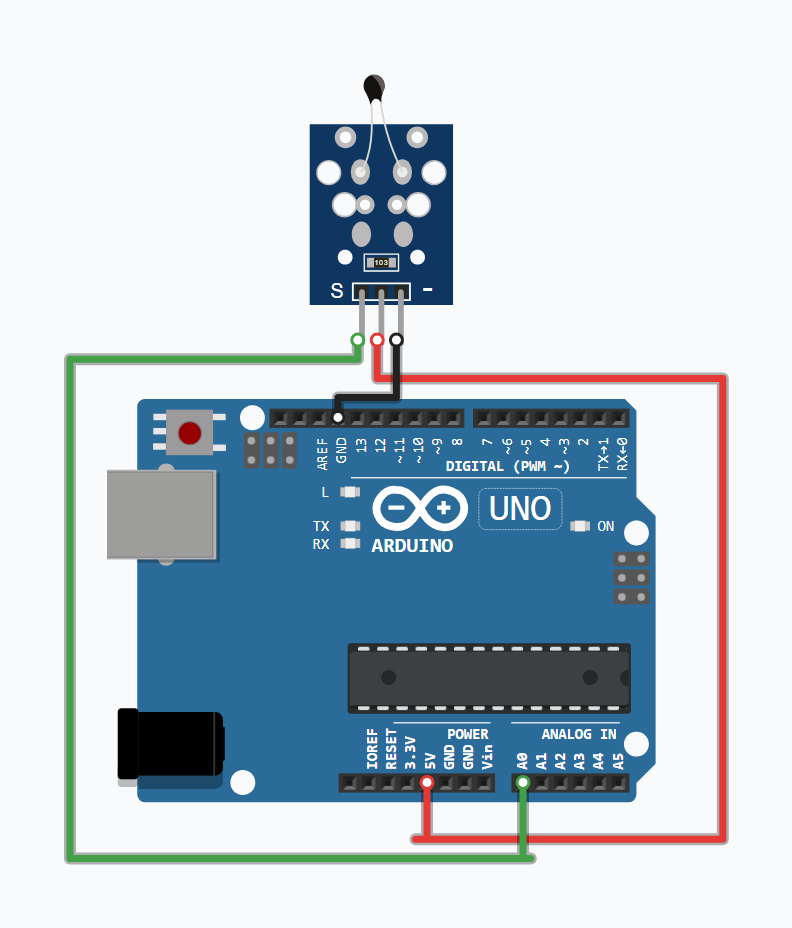
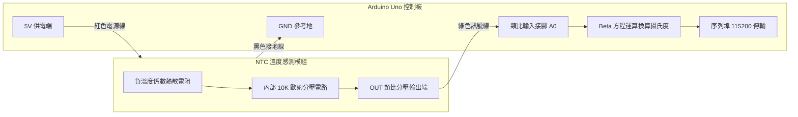

# NTC 熱敏電阻溫度量測實作

## 簡介

透過 NTC 熱敏電阻溫度感測模組讀取環境溫度分壓訊號，微控制器類比數位轉換器取樣後依據 Beta 參數方程換算攝氏溫度，並以 115200 波特率將即時溫度數據傳送至序列埠。

## 硬體接線表

| 元件名稱 | 元件腳位 | Arduino Uno 腳位 | 電氣特性說明 |
| :--- | :--- | :--- | :--- |
| NTC 溫度感測模組 | VCC 電源端 | 5V | 感測電路直流供電端 |
| NTC 溫度感測模組 | GND 接地端 | GND 接地端 1 | 系統共用參考地線 |
| NTC 溫度感測模組 | OUT 訊號端 | 類比接腳 A0 | 溫度感應分壓電位輸出端 |

## 電路佈局圖

### 訊號流向圖

## 電路與韌體設計要點

1. **負溫度係數感測特性**：NTC 為負溫度係數熱敏電阻，當環境溫度上升時阻抗呈現指數型衰減；反之溫度下降時阻抗上升。模組內部搭配固定電阻組成電壓分壓器，將阻抗動態轉換為類比電壓。
2. **Beta 參數數學換算**：程式碼依據熱敏電阻 Beta 方程解析絕對溫度，基準參考點為常溫 25 度對應 298.15 開爾文，計算出開爾文溫度後扣除 273.15 取得標準攝氏度。
3. **浮點數除法防溢位**：運算式採用 `1023. / analogValue - 1`，透過浮點數常數強制編譯器生成雙精確度除法指令，防止整數除法造成精度截斷。
4. **即時序列監控**：主迴圈以 115200 高鮑率持續輸出攝氏數值，便於連接電腦繪圖工具或監控介面即時繪製溫度曲線。

## 模擬方式

* 複製本目錄之 `sketch.ino` 與 `diagram.json` 內容至 Wokwi 線上編輯器即可直接執行模擬。
* 點擊畫面中的 NTC 溫度感測器，畫面將彈出溫度調整滑動桿。拖動滑動桿改變環境溫度，可在 Serial Monitor 視窗中即時觀察換算後的攝氏溫度數值變化。
